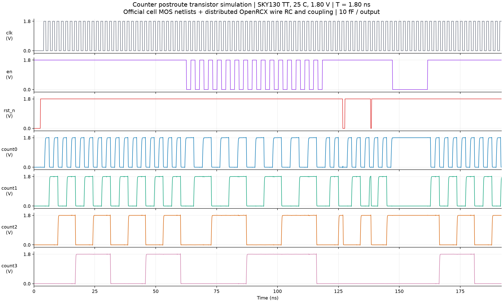

# ngspice 后布线晶体管级仿真

本目录使用 **最终布线网表 + OpenRCX SPEF 分布 RC + SkyWater 官方标准单元晶体管网表**，在 ngspice 45.2 中补充瞬态后仿真。实际执行日志、原始模拟波形、逐项功能检查及生成脚本均保存在本目录。

## 模型与条件

- SKY130 **TT / 25°C / 1.80 V**，时钟周期 **1.80 ns**，50% 占空比。
- 时钟和控制输入全摆幅斜坡为 100 ps，对应 Liberty 的 20%–80% slew **60 ps**；每位输出外接 **10 fF**，与现有 SDC 一致。
- 实例包含 4 个异步清零触发器、10 个组合逻辑单元、3 个 CTS 缓冲器，共 **234 个 MOS 管**。
- 接入 **20 条信号/时钟网、65 个布线电阻、77 个对地电容、61 个耦合电容**。SPEF 中两侧重复记录的耦合电容只实例化一次。布线对地电容总计 43.3101 fF，物理耦合电容总计 5.3618 fF。
- 全部 **55 个单元信号引脚**按 SPEF 节点连接，检查了每个引脚的逻辑网络、RC 连通性、单位和各网电容总量。MOS 模型提供器件电容，未重复加入 Liberty 引脚电容。
- 6 种单元的晶体管类型、W/L、等效并联数量与本机实现平台的 CDL 一致；该检查不等于 LVS。

官方单元模型原文及许可证保留在 `models/`，[SOURCES.json](models/SOURCES.json) 记录下载链接与 SHA-256。器件模型使用本机 PDK，`manifest.json` 记录实际使用的 170 个模型依赖文件及哈希。

## 功能、时序与功耗

仿真时长 **192 ns**，包含 **104 个受检时钟周期**及尾部余量。初始复位后先连续计数两轮，再交替计数与保持以覆盖每个计数值，随后分别在时钟高、低电平期间施加异步复位，最后检查长时间保持和恢复计数。

输出以 **≤0.36 V 为低、≥1.44 V 为高**判断。每周期在外部时钟上升沿后 **0.75 ns** 和 **1.60 ns** 分别核验输出；0.75 ns 对应当前约束的 `1.80 − 1.00 − 0.05 ns` 输出预算。另外检查初始清零、异步复位和复位释放。全部 **213 项功能检查通过**。

波形测量结果约为：

| 项目 | 结果 |
| --- | ---: |
| 时钟上升沿插入延迟 | 0.1845–0.1897 ns |
| 外部时钟到输出延迟 | 0.4333–0.5206 ns |
| 触发器本地时钟到 Q 延迟 | 0.2485–0.3303 ns |
| 输出 20%–80% 转换时间 | 0.0792–0.2381 ns |
| 连续计数的 VDD 平均功耗 | 约 221.0 µW |
| 使能关闭、时钟仍运行的 VDD 平均功耗 | 约 131.6 µW |

延迟取 **0.9 V（50% VDD）**交点，测量了 143 次正常输出转换；时钟插入延迟覆盖四个触发器。连续计数功耗积分窗口为 **32.8–61.6 ns**（完整 16 周期），保持场景为 **149.8–162.4 ns**（7 周期）；计算 `P = −1.8 × I(VDD)`，报告的是理想 VDD 电源提供的能量，不包含输入电压源提供的能量。

采用 2 ps 和 1 ps 最大时间步长复核，两次均通过全部功能检查。1 ps 最终仿真记录 **193393 个数据点**；最大时钟到输出延迟相差 **0.0244 ps**，连续计数平均功耗相差 **0.002714%**，数值稳定性检查通过。精确结果和差异见 [summary.json](reports/summary.json) 及 [2 ps 参考结果](reports/timestep_2ps_reference.json)。

本次结果与 [OpenROAD STA/功耗报告](../openroad/postroute_1p8ns/README.md) 保持独立：两者使用不同的单元和功耗模型，不能将 ngspice 的电源功耗与 `report_power` 视作同一口径直接相减。既有 STA 报告继续作为静态约束与完整路径检查的依据。

## 波形与产物



| 文件 | 内容 |
| --- | --- |
| [results/counting_zoom.png](results/counting_zoom.png) | 连续计数和溢出放大图 |
| [results/timing_zoom.png](results/timing_zoom.png) | 时钟插入、时钟到 Q 和电源功耗细节 |
| `results/*.svg` | 可缩放波形图 |
| `results/transient.raw` | ngspice 二进制原始波形，含输入、输出、内部时钟/Q/复位及电源电流 |
| `results/transient.tsv` | 同一波形的文本数据，时间单位 s、电压 V、电流 A |
| [reports/summary.json](reports/summary.json) | 功能、延迟和电源功耗汇总 |
| [reports/functional_checks.csv](reports/functional_checks.csv) | 213 项检查的时间、期望值、实际电压和结论 |
| [reports/timing_measurements.csv](reports/timing_measurements.csv) | 每次正常输出转换的延迟和 slew |
| [reports/netlist_audit.json](reports/netlist_audit.json) | 电路规模和 SPEF 转换核验 |
| [reports/node_map.tsv](reports/node_map.tsv) | SPICE 节点与 SPEF 节点对应关系 |
| [reports/cell_model_geometry_check.json](reports/cell_model_geometry_check.json) | 官方单元模型与平台 CDL 的器件尺寸核对 |
| [inputs/counter_postlayout.spice](inputs/counter_postlayout.spice) | 带分布 RC 的电路子电路 |
| [inputs/counter_tb.spice](inputs/counter_tb.spice) | 实际 ngspice 激励、负载和分析设置 |
| [inputs/stimulus.json](inputs/stimulus.json) | 功能激励时间表和波形列顺序 |
| [logs/ngspice.log](logs/ngspice.log) | ngspice 运行日志 |
| [manifest.json](manifest.json) | 工具版本、输入、器件模型和产物哈希 |

在 ngspice 交互模式查看原始波形：从本目录启动 `ngspice`，然后输入：

```text
load results/transient.raw
plot v(clk) v(count0) v(count1) v(count2) v(count3)
```

## 复现

从项目根目录运行：

```sh
bash ngspice/run.sh
```

依赖 ngspice、Python 3、NumPy、Matplotlib。本次已在 `/tmp/counter_ngspice_python` 安装波形分析依赖；若重启后该目录被清理，先执行：

```sh
python3 -m pip install --target /tmp/counter_ngspice_python -r ngspice/requirements.txt
```

`SKY130_PDK` 可指定器件 PDK 根目录，默认 `/home/bailufrost/eda/pdk/sky130A`；`NGSPICE_PYTHON_DEPS` 可指定 Python 包目录，`NGSPICE_MAXSTEP_PS` 可指定最大时间步长，入口脚本默认为 1 ps。仿真在 `/tmp/counter_dff_ngspice_*` 中运行后复制产物，避开 HGFS 的中间文件问题。本地 `.spiceinit` 设置 SKY130 兼容选项，不依赖修改用户配置。

## 覆盖范围

本次接入的是 **OpenRCX 提取的信号/时钟布线 RC**。官方标准单元 SPICE 网表包含 MOS 拓扑和尺寸，但没有完整单元内部金属 RC、显式扩散结面积/周长的版图提取信息；因此这是“晶体管单元模型 + 后布线寄生”的后仿真，**尚非完整 GDS 级 PEX 后仿真**。电源使用理想电压源，未提取电源网格/封装寄生，未计 tap/endcap/filler，也未运行 SS/FF 等多角验证。

瞬态结果验证了当前激励下的工作行为，不能替代全部 setup/hold、recovery/removal 和多角 STA。保留原有电路和布线文件。

参考：[SkyWater 官方标准单元库](https://github.com/google/skywater-pdk-libs-sky130_fd_sc_hd)、[ngspice 官方 SKY130 模型使用说明](https://ngspice.sourceforge.io/applic.html)。
