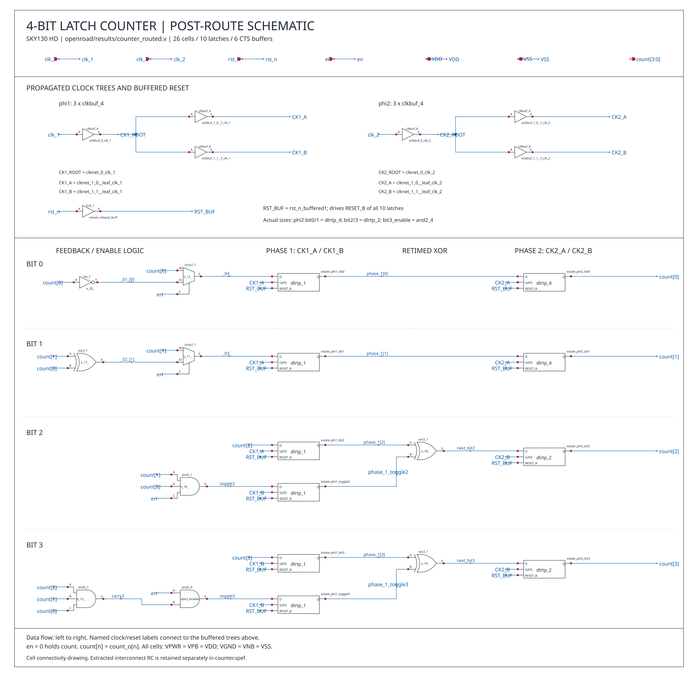

# 后布线电路的 xschem 原理图

已根据当前 [后布线网表](openroad/results/counter_routed.v) 绘制 [counter_postroute.sch](counter_postroute.sch)，使用已安装的 SKY130A 标准单元符号库。图中保留实际的单元类型、驱动尺寸、时钟树分支及复位缓冲器。

预览：[SVG 矢量图](counter_postroute.svg)、[PNG 图片](counter_postroute.png)（3400 × 3300）。



## 在 xschem 中打开

在项目目录运行：

```sh
xschem --rcfile ./xschemrc ./counter_postroute.sch
```

使用与原 `counter_sky130.sch` 相同的 SKY130A 符号库，默认位置为 `$HOME/eda/pdk/sky130A`，也可通过项目 `xschemrc` 的 `PDK_ROOT` 设置路径。原布线前原理图保持独立。

## 图纸内容

上方为两相时钟树和复位缓冲器，下方按 bit 0～3 展示使能/反馈逻辑、phi1 锁存器、重定时 XOR 及 phi2 输出锁存器。相同网络标签表示电气连接。

| 单元类型 | 数量 | 用途 |
| --- | ---: | --- |
| `dlrtp_1` | 6 | phi1 锁存器 |
| `dlrtp_4` | 2 | phi2 bit0、bit1，后布线实际尺寸 |
| `dlrtp_2` | 2 | phi2 bit2、bit3，后布线实际尺寸 |
| `clkbuf_4` | 6 | 每相一个根缓冲器、两个叶缓冲器 |
| `buf_1` | 1 | `reset_release_buf1`，驱动全部 latch 的 RESET_B |
| `mux2_1` | 2 | bit0、bit1 保持/递增选择 |
| `xor2_1` | 3 | 递增与重定时逻辑 |
| `and3_1` | 2 | bit2、bit3 翻转条件 |
| `and2_4` | 1 | `bit3_enable`，后布线实际尺寸 |
| `inv_1` | 1 | bit0 递增逻辑 |
| **合计** | **26** | **10 个 latch、6 个 CTS 缓冲器、1 个复位缓冲器、9 个逻辑门** |

为便于阅读，较长的时钟和复位网络在图中使用以下简称，映射关系也标在图上：

| 图中网络 | 后布线网表网络 | 接收单元 |
| --- | --- | --- |
| `CK1_ROOT` | `clknet_0_clk_1` | phi1 两个叶缓冲器 |
| `CK1_A` | `clknet_1_0__leaf_clk_1` | phi1 bit0、bit1、bit2 |
| `CK1_B` | `clknet_1_1__leaf_clk_1` | phi1 bit3、toggle2、toggle3 |
| `CK2_ROOT` | `clknet_0_clk_2` | phi2 两个叶缓冲器 |
| `CK2_A` | `clknet_1_0__leaf_clk_2` | phi2 bit0、bit1 |
| `CK2_B` | `clknet_1_1__leaf_clk_2` | phi2 bit2、bit3 |
| `RST_BUF` | `rst_n_buffered1` | 全部 10 个 latch 的 RESET_B |

`count[n]` 与网表中的 `count_o[n]` 由原网表的 assign 相连，在图中合并。实例名前保留 xschem/SPICE 的 `x` 前缀，其后与后布线实例名一致。

顶层电源端口为后布线网表中的 `VDD` 和 `VSS`，类型为 inout。各符号的电源/衬底属性连接为 `VPWR=VPB=VDD`、`VGND=VNB=VSS`。

## 导出和核对

已实际调用 xschem 导出 Verilog 与 SPICE，并逐项核对：

- 26/26 个实例名称和实际单元类型一致。
- 84/84 个信号引脚连接一致，包括时钟树各分支的接收 latch。
- 104/104 个 SPICE 电源和衬底连接一致。
- 顶层输入、4 位输出及 VDD/VSS 端口一致，无额外或缺失单元。

[核对结果](verification/counter_postroute_connections.txt)、[文件哈希和简称映射](verification/counter_postroute_manifest.json)、[xschem 运行日志](verification/counter_postroute_xschem.log)。

导出文件：[Verilog](simulation/counter_postroute_extracted.v)、[SPICE](simulation/counter_postroute.spice)。导出顶层名为 `counter_postroute`；结构核对时已处理顶层名称、实例 x 前缀和上述网络简称。

在项目目录重新生成图纸、调用 xschem 导出、逐引脚核对并生成 SVG/PNG：

```sh
python3 verification/draw_postroute.py
```

生成器沿用原 `counter_sky130.sch` 的数据通路排版，按实际后布线网表更新单元、时钟和复位连接。修改图纸后执行此命令会重新生成图纸。

这是后布线标准单元的电气连接原理图。互连 RC 保留在 [counter.spef](openroad/results/counter.spef)，未在本图展开为分布电阻、电容；filler/well tap 等仅用于物理实现的实例也未展开。原布局布线、STA 与功耗分析文件未由本次绘图修改。1.73 ns 时序与时钟重叠的分析见 [STA 报告](openroad/fmax_49pct/README.md)，对应功耗见 [功耗报告](openroad/power_1p73ns/README.md)。
