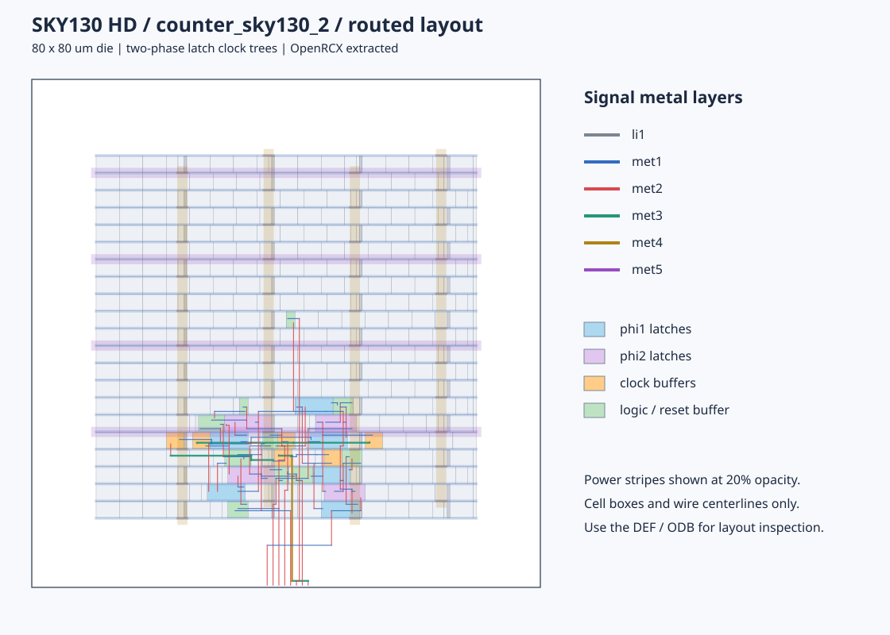

# counter_sky130_2：1.7 ns 布局布线、提取及后布线 STA

> 已补充 [后布线 xschem 电路原理图](../POSTROUTE_SCHEMATIC.md)：完整绘制实际 26 个单元、两相时钟树与复位缓冲器，保留驱动尺寸，并通过 84 个信号引脚及 104 个电源/衬底连接核对。

> 已补充 [1.73 ns / 578.035 MHz 后布线功耗报告](power_1p73ns/README.md)：连续计数 570.835 µW、50% 使能 486.795 µW、保持且时钟运行 401.006 µW，含逐单元明细、测量 VCD 及与原 1.75 ns 的对比。

> 已补充 [最高频率估算与调周期 STA 复核](fmax_49pct/README.md)：常规 STA 极限约 578.12 MHz，1.7298 ns 通过、1.7297 ns 失败；若要求保持 49% 占空比时的锁存器端严格名义非重叠，上限约 431.20 MHz，2.32 ns 同时通过两类检查。

> 已补充 [OpenROAD 后布线功耗报告](power/README.md)：按当前 1.75 ns / 49% 时钟、TT / 25°C / 1.8 V 分析连续计数、50% 使能和保持三种场景。报告包含测量 VCD、完整活动覆盖检查、逐单元明细及复现脚本。

> 已补充 [ngspice 后布线晶体管级仿真](../simulation/postlayout/README.md)：采用实际尺寸的 26 个单元及 SPEF 分布 RC，包含计数/保持/异步复位检查、模拟电压波形、延迟及供电功耗测量，并说明单元内部寄生模型的范围。

> 后续约束更新：项目当前 `counter.sdc` 已改为 1.75 ns / 49%。[最新后布线 STA](sta_1p75ns_49pct/README.md) 中原输出 setup 违例全部消除，输出最差 +0.020060 ns；锁存器端仍有约 5.691 ps 名义时钟重叠。下文保留原 1.7 ns 物理实现和报告，布线及 SPEF 未重做。

已使用 OpenROAD 对项目 `counter_sky130_2.v` 完成重新布局布线、两相 CTS、OpenRCX 寄生提取及传播时钟 STA。保持 **1.7 ns 周期、两相高电平占比 49%**，原 I/O、复位预算和不确定度不变。原始网表和 `counter.sdc` 未修改，分析输入快照及 SHA-256 已保存。

**最终仍有 3 条输出 setup 违例，最差 slack 为 -0.029440 ns，max TNS 为 -0.054726 ns；最差路径已转移到 `state_phi2_bit0/Q → count[0]`。数据 hold、复位 recovery/removal、脉宽与 slew/capacitance 检查通过。**

原 `count[2]` 路径由 −0.075181 ns 改善到 -0.004575 ns；全局最差裕量改善约 **45.741 ps**。严格非重叠仍未满足：phi1 → phi2 的名义时钟包络重叠约 **6.191 ps**。

## 交付文件

- [详细布线 DEF](results/counter_routed.def)、[布线数据库 ODB](results/counter_routed.odb)、[提取数据库 ODB](results/counter_extracted.odb)。
- [后布线网表](results/counter_routed.v)、[OpenRCX SPEF](results/counter.spef)、[有效 STA 约束](reports/postroute/effective.sdc)。
- [完整 STA 汇总](reports/postroute/summary.rpt)、[违例清单](reports/postroute/violations.rpt)、[逐端点裕量](reports/postroute/endpoint_slacks.tsv)。
- [输入网表快照](inputs/counter_sky130_2.v)、[SDC 快照](inputs/counter.sdc)、[输入/输出及工具校验记录](manifest.json)、[复现入口](run_all.sh)。



预览为 DEF 导线中心线和实际单元边界，含淡色电源网格。物理版图交付为 DEF/ODB，未生成 GDS。

## 结构和实现条件

`counter_sky130_2.v` 将 bit2 的 XOR 也放到 phi1 与 phi2 之间，新增 `state_phi1_toggle2`，bit2/bit3 均由 phi1 锁存操作数后经 XOR 送到 phi2。输入网表共有 19 个单元，其中 **10 个锁存器**（phi1 六个、phi2 四个）。

| 项目 | 设置或结果 |
| --- | --- |
| OpenROAD | 26Q2-1164-g08f67ee5ec，2 个线程 |
| 独立交叉验证 | OpenSTA 3.1.0 d1e43c6f9f |
| 工艺 / Liberty | SKY130 HD，TT / 25°C / 1.8 V，沿用项目原 TT 库 |
| 物理平台 | 本地 ORFS sky130hd 技术 LEF、单元 LEF、轨道及 PDN |
| 提取 RC | ORFS sky130hd 指定的 rcx_patterns.rules，nominal 单角 |
| Die / Core 设置 | 80 × 80 µm / (10.12, 10.88)–(70, 70) µm |
| Site / 全局布局目标密度 | unithd / 0.35 |
| 信号 / 时钟布线层 | met1–met5 / met3–met5；末端引脚访问可用低层 |
| 最终时序网表单元数 | 26，含 10 个锁存器、6 个时钟缓冲器和 1 个复位缓冲器 |
| 物理实例数 | 473，含 401 个 filler、46 个 well tap |
| 信号及两相时钟导线 | 约 579 µm，183 个过孔，不含 PDN |
| 提取网络数 | 30，覆盖全部信号及两相时钟网络 |
| 详细布线器最终 DRC | 0 |
| 天线检查 | 0 个网络 / 0 个引脚违例 |
| VDD / VSS 连通性 | 均通过 |

时钟波形：phi1 为 **0.0085–0.8415 ns**，phi2 为 **0.8585–1.6915 ns**；每相高电平 0.833 ns，两个端口死区均为 0.017 ns。所有 I/O/复位 delay、输出负载和时钟不确定度直接沿用 SDC。

## 后布线时序

| 检查 | 最差 slack ns |
| --- | ---: |
| 锁存器数据 Setup | +0.000000 |
| 锁存器数据 Hold | +0.027322 |
| 输出 Setup | -0.029440 |
| 输出 Hold | +0.497189 |
| phi1 → phi2 Setup | +0.248676 |
| phi1 → phi2 Hold | +0.267429 |
| phi2 → phi1 Setup | +0.004750 |
| phi2 → phi1 Hold | +0.298878 |
| 复位 Recovery | +0.240338 |
| 复位 Removal | +0.215387 |

max/setup WNS 为 **-0.029440 ns**，max TNS 为 **-0.054726 ns**；min 最差为 **+0.027322 ns**，min TNS 为 **0.000000 ns**。

| 违例路径 | slack ns |
| --- | ---: |
| `state_phi2_bit0/Q` → `count[0]` | -0.029440 |
| `state_phi2_bit1/Q` → `count[1]` | -0.020711 |
| `state_phi2_bit2/Q` → `count[2]` | -0.004575 |

最差路径从 phi2 上升沿 **0.858500 ns** 出发，经过实际时钟树、`state_phi2_bit0` 的 GATE→Q 和输出导线，到达 `count[0]` 的时间为 **1.520940 ns**。输出以 phi1 下一周期下降沿 2.541500 ns 为参考，扣除 0.05 ns 不确定度和 1.00 ns output delay，要求时间为 **1.491500 ns**，因此 slack 为 **−0.029440 ns**。

`count[3]` 的 setup 已为 +0.010054 ns。锁存器 D 端的 0 ns 条目标记为 `MET`，对应合法时间借用，应与负 slack 输出违例区分。`-violators` 输出包含 0 ns 的 `MET` 条目，文件非空不能直接作为违例判据。

`check_setup -verbose` 无告警，仅表示约束完整性检查通过。48 项 max/min 结果覆盖 10 个 D、10 个 RESET_B 和 4 个 count 输出；OpenROAD 与独立 OpenSTA 的逐端点结果完全一致。SPEF 逐项匹配全部实际信号/时钟网络，无部分注释驱动端；注释报告列出的未注释端仅为电源端口 VDD/VSS。

高电平最小脉宽最差裕量为 +0.615232 ns；最大转换时间最差裕量 +1.090001 ns，最大电容最差裕量 +0.073524 pF。`min_period.rpt`、`max_fanout.rpt` 为空，表示本次无可报告的对应限制。

## 与上一版在 1.7 ns 下比较

| 输出端 | counter_sky130_1 slack ns | counter_sky130_2 slack ns | 改善 ns |
| --- | ---: | ---: | ---: |
| `count[0]` | -0.039458 | -0.029440 | +0.010018 |
| `count[1]` | -0.031833 | -0.020711 | +0.011122 |
| `count[2]` | -0.075181 | -0.004575 | +0.070606 |
| `count[3]` | -0.029418 | +0.010054 | +0.039472 |

上一版的 max TNS 为 −0.175890 ns、4 条输出 setup 违例；新版本为 -0.054726 ns、3 条。原最差 `count[2]` 路径改善，但最差输出转移到 count[0]，未达到全部时序收敛。

这是两份物理实现的最终结果对比。新版本按 1.7 ns 重跑了布局布线与尺寸优化，旧版本最初按 2 ns 建成后在 1.7 ns 重分析，因此上述差异不能全部归因于重定时。原记录见 [上一版 1.7 ns 报告](../openroad_sky130_1/sta_1p7ns_49pct/README.md)。

## 两相时钟端的非重叠

| 方向 | 端口死区 ns | 锁存器端最差名义间隔 ns |
| --- | ---: | ---: |
| phi1 关闭 → phi2 开启 | 0.017000 | -0.006191 |
| phi2 关闭 → 下一周期 phi1 开启 | 0.017000 | +0.002370 |

phi1 最晚下降沿为 0.841500 + 0.279602 = 1.121102 ns，phi2 最早上升沿为 0.858500 + 0.256411 = 1.114911 ns，相差 −0.006191 ns，即名义重叠 6.191 ps。反向仍有 2.370 ps 正间隔。这是全部锁存器 GATE 端的 TT 名义时钟包络，未扣除抖动或不确定度，严格非重叠要求未满足；该检查独立于数据 hold。

## 优化和验证

流程包括 floorplan、I/O 放置、tap/PDN、全局/详细布局、CTS、复位缓冲、placement RC 下的 setup 优化、全局布线寄生下的 setup 优化、重新详布、filler、PDN 连通检查和 OpenRCX 提取。添加的复位缓冲器计入真实延迟，不放宽外部复位预算。

原始单元的最终尺寸变化：

- `bit3_enable`：`sky130_fd_sc_hd__and2_1` → `sky130_fd_sc_hd__and2_4`。
- `state_phi2_bit0`：`sky130_fd_sc_hd__dlrtp_1` → `sky130_fd_sc_hd__dlrtp_4`。
- `state_phi2_bit1`：`sky130_fd_sc_hd__dlrtp_1` → `sky130_fd_sc_hd__dlrtp_4`。
- `state_phi2_bit2`：`sky130_fd_sc_hd__dlrtp_1` → `sky130_fd_sc_hd__dlrtp_2`。
- `state_phi2_bit3`：`sky130_fd_sc_hd__dlrtp_1` → `sky130_fd_sc_hd__dlrtp_2`。

首次完整详布/提取结果保留在 [first_pass](first_pass/reports/postroute/summary.rpt)。增加全局布线寄生优化后，优化器未接受进一步修改，最终负裕量仍存在；日志中的 `RSZ-0062` 与这一结果一致。

Yosys 使用同一 Liberty 功能模型，将输入 `counter_sky130_2.v` 与本次后布线网表展开，并以 `clk2fflogic` 处理锁存器后检查功能等价：**28 个等价点全部证明通过**。这验证本次物理缓冲和尺寸优化相对 `_2.v` 的零延迟功能保持，不是 `_1.v` 与 `_2.v` 的重定时等价证明。真实电气延迟由后布线 STA 检查。

详细布线器日志含 `DRT-0349`：该版本忽略没有 CUTCLASS 的 LEF58_ENCLOSURE 条目。0 DRC 为布线器已实现规则范围内的结果，未进行完整晶圆厂 DRC/LVS、金属密度填充或多角/OCV/SI 签核。

## 报告和复现

- [布线日志](logs/pnr.log)、[CTS 统计](reports/cts.rpt)、[DRC 状态](reports/route_status.rpt)、[天线/布局检查](logs/layout_check.log)、[功能等价](logs/equivalence.log)。
- [全部时序/电气检查](reports/postroute/checks.rpt)、[Setup 违例详细路径](reports/postroute/setup_violations.rpt)、[数据 Hold](reports/postroute/data_hold.rpt)。
- [时钟传播延迟](reports/postroute/clock_latency.rpt)、[非重叠计算](reports/clock_nonoverlap.rpt)、[SPEF 注释](reports/postroute/parasitic_annotation.rpt)、[独立 STA 汇总](reports/standalone_sta/summary.rpt)。

在项目目录运行：

```bash
bash openroad_sky130_2/run_all.sh
```

入口读取 `inputs/` 中的快照，重新生成最终实现、SPEF、STA、物理与等价检查、manifest 及版图预览，不覆盖 first_pass 或上一版目录。工具正常完成但时序未收敛时仍保存报告，manifest 的 `conventional_sta_passed` 为 false。可用 `SKY130HD_PLATFORM` 指定兼容平台路径。
