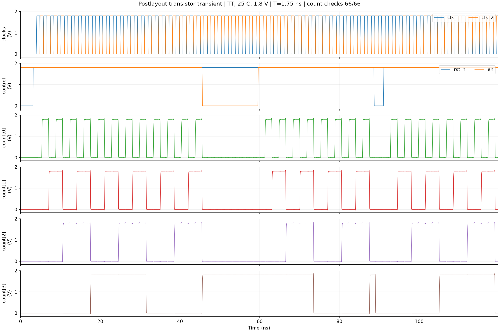
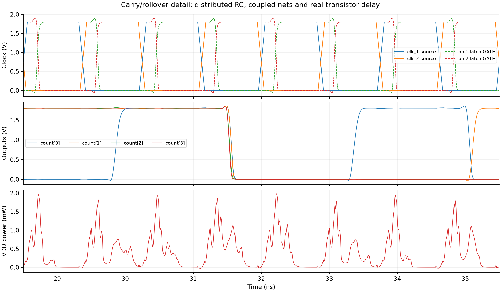

# ngspice 后布线晶体管级仿真

在当前 **1.75 ns / 49% 两相时钟、TT / 25°C / 1.8 V** 条件下完成 ngspice 瞬态仿真。
**66/66 个周期的计数检查通过，8 周期保持检查通过，启动复位及运行中异步复位的全部 10 个锁存器清零检查通过。**

5 ps 和 2.5 ps 最大步长两次完整仿真均通过检查。结果针对所列激励及单一 TT 角。



## 电路与寄生模型

- 使用 `openroad/results/counter_routed.v` 和 `openroad/results/counter.spef`，保留实际单元尺寸、6 个 CTS 缓冲器和复位缓冲器。
- 转换后含 **26 个单元、364 个 MOS、30 个 SPEF 网络、103 个电阻、119 个对地电容、102 个耦合电容**。
- SPEF 中同一耦合电容在两端网络中重复列出，转换时核对数值并只保留一次。耦合电容保持跨网络连接，未折算为对地电容。
- 84 个单元信号引脚与 8 个顶层信号端口逐一匹配，检查分布 RC 连通性、各网络电容合计及端口别名；[转换明细](netlists/conversion.json)、[节点映射](netlists/nodes.tsv)。
- 单元来自 [SkyWater HD 上游晶体管网表](https://github.com/google/skywater-pdk-libs-sky130_fd_sc_hd)，本机副本提交为 `9cb2d7cb8ed4619094263614039a61b6b2d22a88`。MOS 模型使用已安装 SKY130A TT 的原始 `nfet_01v8` / `pfet_01v8_hvt` 定义及其 special 包装；加载所需器件类型，模型参数未改写。保留 PDK 的 `scale=1u`。
- **单元使用上游晶体管连接网表，未额外提取单元内部金属及扩散区寄生；因此本次是“晶体管模型 + 后布线互连 RC”仿真，不等同于完整 GDS 级 PEX。**

## 激励与检查

- 两相频率 571.428571 MHz，各相高电平宽度 0.8575 ns，50% 电压交越处的端口死区为 17.5 ps。
- 电压上升/下降时间为 100 ps（20%–80% 为 60 ps），与现有 SDC 的 60 ps 输入转换时间口径对应；每位输出接 10 fF 负载。
- t=0 时 rst_n=0，约 3.15 ns 释放，4 ns 后启动两相时钟。初始状态由 DC 解和真实复位建立，未强制设置锁存器初始值。
- 周期 0–23 连续计数，24–31 保持在 8，32–47 恢复计数；约 88.7 ns 异步拉低复位，约 91.1 ns 释放；周期 50–65 再次计数并回卷。
- 每周期在 `4 + (cycle + 0.985) × 1.75 ns` 采样输出；判低 ≤0.36 V、判高 ≥1.44 V，中间电平判为无效。另检查整个保持窗口的电平和两次复位的 10 个 Q 端。
- [逐周期采样及预期值](results/nominal_samples.csv)、[机器可读检查结果](results/nominal_summary.json)。

## 延迟与两相交接

下表为 **端口 clk_2 的 0.9 V 上升交越 → 对应 count 输出的 0.9 V 交越**，含时钟树与输出布线延迟。统计发生实际输出翻转且在采样点前完成的事件；不等同于单个锁存器的 GATE→Q 延迟。

| 输出 | 最小延迟 ps | 最大延迟 ps |
| --- | ---: | ---: |
| count[0] | 426.738 | 487.073 |
| count[1] | 424.450 | 482.670 |
| count[2] | 400.800 | 476.775 |
| count[3] | 395.548 | 461.158 |

锁存器端的时钟间隔按全部 phi1/phi2 GATE 的 0.9 V 交越包络计算：

| 方向 | 最小间隔 ps | 最大间隔 ps |
| --- | ---: | ---: |
| phi1 关闭 → phi2 开启 | -21.102 | -21.058 |
| phi2 关闭 → 下一周期 phi1 开启 | -14.508 | -14.456 |

负值表示在 0.9 V 判据下存在名义重叠。有限激励下的功能检查通过不能代替严格非重叠、setup/hold 或多角验证；晶体管连接网表的单元寄生范围与 Liberty STA 模型不同，间隔数值不要求与先前 STA 完全一致。



## 瞬态供电功耗

以 `P(t) = -1.8 × I(VDD)` 对稳定窗口积分，包含本模型中的器件短路/充放电电流及互连活动；不含理想输入激励源提供的能量、片外时钟驱动器或电源网格损耗。

| 场景 | 积分窗口 ns | VDD 平均功耗 µW | 每周期供电能量 pJ |
| --- | --- | ---: | ---: |
| 连续计数（16 周期） | 11.000–39.000 | 413.699 | 0.723973 |
| 保持（时钟继续运行，6 周期） | 47.750–58.250 | 277.234 | 0.485159 |

这是当前 SPICE 模型及有限激励窗口的测量值，与 [OpenROAD 的 Liberty 活动功耗估算](../../openroad/power/README.md) 的模型和统计口径不同。由于单元内部寄生范围有限，本结果不替代完整 PEX 的功耗签核。

## 数值验证与复现

- ngspice 45.2，KLU，Gear 2 阶，reltol=1e-4、abstol=1e-12 A、vntol=1e-6 V。
- 5 ps → 2.5 ps 最大步长：连续计数平均功耗变化 0.028918%，保持功耗变化 0.049778%，时钟到输出延迟区间端点最大变化 0.731644 ps；两次功能检查均通过。
- 使用 `.option minbreak=1e-15`，通过 `.tran` 卡和 `run` 启动，避免旧版 ngspice 在几乎重合断点处出现浮点时间步长问题。该设置远小于 100 ps 激励边沿；依据 [ngspice #887](https://sourceforge.net/p/ngspice/bugs/887/) 和 [#888](https://sourceforge.net/p/ngspice/bugs/888/) 的官方说明。
- 最终日志：[5 ps](logs/nominal.log)、[2.5 ps](logs/refined.log)。[输入、模型及交付文件 SHA-256](manifest.json)。

在项目根目录执行：

```sh
bash simulation/postlayout/run_all.sh
```

依赖 ngspice、Python、NumPy、Matplotlib。可通过 `POSTLAYOUT_PYTHON` 指定 Python，`POSTLAYOUT_PYTHONPATH` 指定第三方包目录；本次绘图使用本机 `/tmp/counter_ngspice_python` 中已安装的包。可通过 `PDK_ROOT` 和 `SKY130_HD_SOURCE` 指定工艺模型和上游单元来源目录。

仅重新生成网表和激励：`python3 simulation/postlayout/run.py --prepare-only`。仅重新分析已有结果：`python3 simulation/postlayout/analyze.py`。

可直接查看 [5 ps 完整 ngspice RAW](results/nominal.raw)、[10 ps 间隔顶层波形 CSV](results/nominal_waveforms.csv)、[时钟间隔 CSV](results/nominal_clock_gaps.csv)、[时钟到输出延迟 CSV](results/nominal_clock_to_output.csv)。完整 RAW 保留自适应步长及内部锁存器 GATE/Q 波形，CSV 供快速查看。
