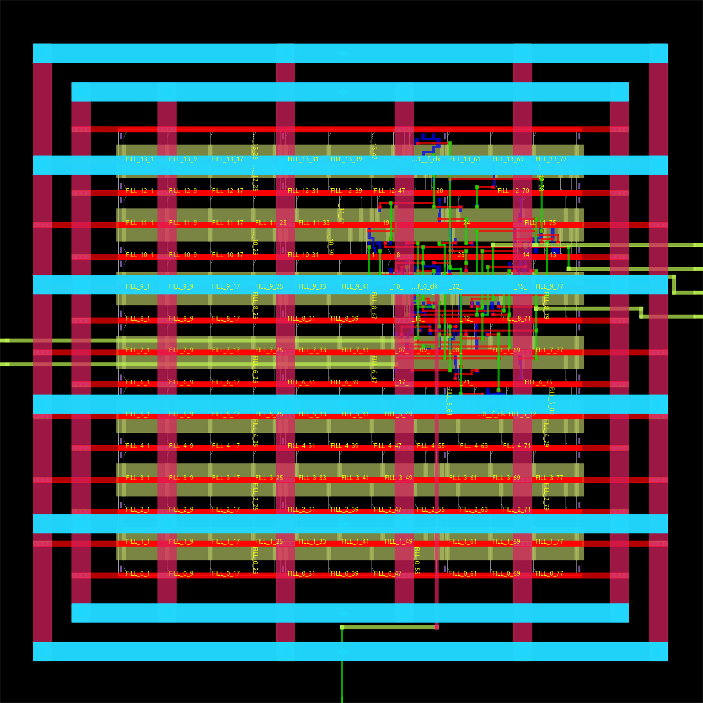

# Counter 的 OpenROAD 布局布线

完整结果保存在 **`run_03/`**。已完成网表、SDC、LEF 和 Liberty 导入，
布局规划、IO 放置、well tap/端部单元、电源网络、全局/详细单元放置、
CTS、filler、全局布线和详细布线。

后续 **1.8 ns ngspice 后仿真** 复用该布线结果与 `pex_02/` 的寄生参数，
包括实际 CTS、标准单元晶体管模型和分布式互连 RC，详见
[仿真报告](../xschem/ngspice/postlayout_1p8ns_01/README.md)。

`run_03/` 的布局布线阶段停止在详细布线之后，没有执行寄生提取或后布线 STA。
后续独立寄生提取结果保存在 **`pex_02/`**，见
[`EXTRACTION.md`](EXTRACTION.md)。最新后布线 STA 报告保存在
**[`sta_postroute_1p8ns_01/`](sta_postroute_1p8ns_01/README.md)**：时钟改为 **1.8 ns**，
setup/hold 均无违例，最差输出 setup 余量 **+0.010795 ns**，hold 最差余量 **+0.035018 ns**。
2 ns 的通过记录保存在 [`sta_postroute_2ns_01/`](sta_postroute_2ns_01/README.md)。
原 1.65 ns 的四个输出 setup 违例记录保存在
[`sta_postroute_02/`](sta_postroute_02/README.md)。对比见 [`POST_ROUTE_STA.md`](POST_ROUTE_STA.md)。
各历史阶段的数据库与检查记录保持原样。

## 结果

| 项目 | 结果 |
| --- | --- |
| OpenROAD | `26Q2-1164-g08f67ee5ec` |
| 工艺 / 库 | SKY130 HD，`sky130_fd_sc_hd`，TT、1.8 V、25°C |
| 时钟约束 | 1.65 ns，波形 `{0.825 1.65}` |
| Die | 60 × 60 µm |
| Core | `(10.12, 10.88)`–`(49.68, 48.96)` µm；1506.4448 µm² |
| 放置网格 | `unithd`，86 sites × 14 rows；site 为 0.46 × 2.72 µm |
| 原始标准单元 | 18 个，包含 4 个 `dlxtn_1`、4 个 `dlxtp_1` |
| 原始单元面积 / core 占比 | 178.9216 µm² / 约 11.88%（不含后来加入的物理单元） |
| CTS | 3 个 `clkbuf_4`；8 个 latch sink；每条时钟路径均经过 2 级缓冲器 |
| CTS 平衡负载 | 1 个 `clkbuf_1`，`clkload0`；输出 X 有意不连接 |
| Well tap / 端部单元 | 16 / 28，均使用 `tapvpwrvgnd_1` |
| Filler | 169 个 |
| 最终总实例数 | 235 |
| 信号/时钟网络 | 24 条，全部布通；另有 VDD/VSS 两条电源网络 |
| 全局布线拥塞溢出 | 0 |
| 详细路由器最终 DRC | 0，`detailed_route_drc.rpt` 为空 |
| 信号/时钟布线总长 | 约 477 µm；逐网络报告求和为 476.95 µm |
| 详细路由器过孔统计 | 156 |
| 放置合法性 | 通过 |
| VDD/VSS 连通性 | 均通过 |

已从 OpenDB 导出的实例/引脚表核对：原始 18 个单元的型号保持一致，
全部数据引脚网络保持一致；8 个 latch 的 GATE/GATE_N 均经非反相 CTS 缓冲器
回溯到原始 `clk`，不存在遗漏或反相时钟路径。该检查是连接核对，未进行时序签核。



[信号布线图](run_03/images/routed_signals.png) ·
[时钟布线局部图](run_03/images/clock_tree.png) ·
[CTS 连接拓扑图](run_03/images/cts_topology.svg)

## 主要交付文件

| 文件 | 用途 |
| --- | --- |
| [`run_03/results/08_routed.odb`](run_03/results/08_routed.odb) | 完整 OpenROAD 数据库，包含技术、单元、放置、电源和详细布线 |
| [`run_03/results/08_routed.def`](run_03/results/08_routed.def) | 最终详细布线 DEF |
| [`run_03/results/counter_routed.v`](run_03/results/counter_routed.v) | 保留 CTS、剔除 tap/filler 的网表；顶层含 VDD/VSS 端口 |
| [`run_03/results/counter_routed_power.v`](run_03/results/counter_routed_power.v) | 含物理单元和显式电源/阱连接的完整网表 |
| [`run_03/results/08_routed.sdc`](run_03/results/08_routed.sdc) | 保留 IO 预算并设为 propagated clock 的物理实现约束 |
| [`run_03/results/counter.guide`](run_03/results/counter.guide) | 全局布线 guides |
| [`run_03/reports/cts.rpt`](run_03/reports/cts.rpt) | CTS 缓冲器、sink 和平衡负载统计 |
| [`run_03/reports/clock_paths.tsv`](run_03/reports/clock_paths.tsv) | 每个 latch 的时钟网络和两级缓冲器路径 |
| [`run_03/reports/physical_checks.txt`](run_03/reports/physical_checks.txt) | 放置、信号布通和电源连通性检查 |
| [`run_03/reports/wire_length_by_net.rpt`](run_03/reports/wire_length_by_net.rpt) | 逐网络、逐层布线长度 |
| [`run_03/reports/verification.json`](run_03/reports/verification.json) | 机器可读的结果及连接核对记录 |
| [`run_03/logs/flow.log`](run_03/logs/flow.log) | 完整实现日志，含最终拥塞和路由 DRC 统计 |
| [`run_03/manifest.json`](run_03/manifest.json) | 输入数据路径和 SHA-256、主要输出文件哈希 |

`results/01_import` 至 `08_routed` 各阶段均保存 ODB、DEF、Verilog 和 SDC。
该流程没有 GDS 流片输出或签核 DRC/LVS；上述 DRC 数目是 OpenROAD 根据 LEF
规则检查得到的路由器结果。工具日志记录了不支持的部分 LEF58 enclosure 条目，
不能把路由器 DRC=0 等同于 foundry 全规则签核。

## 输入数据与实现选择

原网表 `../counter_mapped.v` 和约束 `../counter_opt.sdc` 均保持不变，
本次执行时的精确副本保存在 `run_03/inputs/`。

`counter_opt.sdc` 注释中的 1.58 ns 与实际命令不同；本轮采用
`create_clock -period 1.65 -waveform {0.825 1.65}` 的实际值。
CTS 后只在导出的物理 SDC 中去掉原来的理想网络/引脚零 latency，
设置 propagated clock，保留 source latency 和 IO delay、load、transition、uncertainty。
SDC 写出时出现的约 1.649999976 ns 是工具内部浮点数序列化，设计周期仍为 1.65 ns。

SKY130 HD 物理库来自：

```text
$HOME/eda/OpenROAD-flow-scripts-live/flow/platforms/sky130hd/
  lef/sky130_fd_sc_hd.tlef
  lef/sky130_fd_sc_hd_merged.lef
  lib/sky130_fd_sc_hd__tt_025C_1v80.lib
```

技术 LEF 定义金属/过孔/放置 site，合并单元 LEF 提供 441 个单元的物理抽象，
Liberty 提供逻辑、时钟引脚和 CTS 缓冲器特性。
实际路径和哈希见 manifest。本机 CIEL 的 SKY130A 主要提供器件模型，
缺少该实现所需的完整标准单元物理库，故这里使用 ORFS 配套的 SKY130 HD 数据。

IO 安排为底部 `clk`、左侧 `en/rst_n`、右侧 `count[3:0]`。
电源使用 met1 行电源轨、met4/met5 电源环和条带；
`VPWR/VPB` 接 VDD、`VGND/VNB` 接 VSS。
信号全局布线范围设置为 met1–met5，时钟主干范围设置为 met3–met5；
局部引脚接入和短距离分支可使用下层金属。

放置采用线长/密度驱动，没有运行 timing-driven placement 或 setup/hold 修复。
CTS 复用平台 `setRC.tcl` 的单位长度 RC 查找值进行缓冲器表征/建树，
没有调用 `estimate_parasitics`、`extract_parasitics` 或读取/生成 SPEF。
本流程使用独立 Tcl，未触发 ORFS 默认的 final/extraction/STA 阶段。

## 查看与重跑

在 counter 项目目录打开最终数据库：

```sh
sh openroad/open.sh
```

或者：

```sh
openroad -gui -no_init openroad/view.tcl
```

`view.tcl` 读取数据库、Liberty 和 SDC 供显示/分类，不运行时序报告，
并将完整布局、信号布线和时钟局部图导出到运行目录的 `images/`。

重新实现，必须使用新输出目录：

```sh
sh openroad/run.sh openroad/run_repeat01
COUNTER_PNR_RUN="$PWD/openroad/run_repeat01" \
  openroad -no_init -exit openroad/audit.tcl
COUNTER_PNR_RUN="$PWD/openroad/run_repeat01" \
  openroad -gui -no_init -exit openroad/view.tcl
python3 openroad/verify.py openroad/run_repeat01
```

也可不给 `run.sh` 参数，自动创建带时间戳的新目录。
`COUNTER_SKY130_PLATFORM` 可指定其他具有相同文件结构的 SKY130 HD 平台目录。
`run_03/inputs/flow.tcl` 是本次实际执行的 Tcl 副本。
