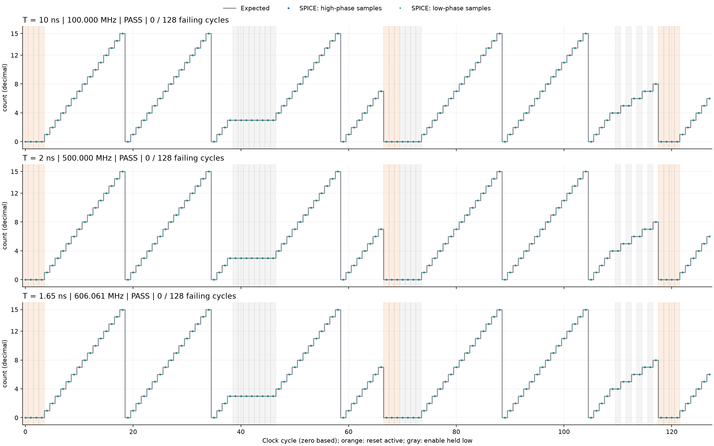

# ngspice 仿真结果：10 ns、2 ns、1.65 ns

三种周期均通过本次晶体管级功能检查：连续模 16 计数、5 次完整回绕、
非零/零状态的使能保持、使能有效/无效时的同步清零，以及复位后的重新计数均正确。
每组实际时钟上升沿和输入控制电平也与设定一致。

## 主仿真结果

| 周期 / ns | 频率 / MHz | 仿真时长 / ns | 检查周期数 | 高相采样错误 | 低相采样错误 | 稳定区间错误 | 结果 |
| ---: | ---: | ---: | ---: | ---: | ---: | ---: | --- |
| 10 | 100.000 | 1284.5 | 128 | 0 | 0 | 0 | PASS |
| 2 | 500.000 | 256.9 | 128 | 0 | 0 | 0 | PASS |
| 1.65 | 606.061 | 211.9425 | 128 | 0 | 0 | 0 | PASS |

每周期采样两次，总共检查 768 次总线采样和 384 段稳定区间。
三组均遍历 count=0…15，最后一次检查值均为 6。
完整对比图的横轴按时钟周期归一化，便于比较同一逻辑序列；
各组模拟电压波形图的横轴则为真实时间 ns。

## 波形和逐周期结果

| 周期 | 模拟电压与计数波形 | 中途复位/使能波形 | 15→0 回绕与 master 节点 | 逐周期检查 |
| --- | --- | --- | --- | --- |
| 10 ns | [波形](results/T_10ns/waveforms.png) | [复位/使能](results/T_10ns/reset_and_enable.png) | [回绕细节](results/T_10ns/carry_detail.png) | [samples.csv](results/T_10ns/samples.csv) |
| 2 ns | [波形](results/T_2ns/waveforms.png) | [复位/使能](results/T_2ns/reset_and_enable.png) | [回绕细节](results/T_2ns/carry_detail.png) | [samples.csv](results/T_2ns/samples.csv) |
| 1.65 ns | [波形](results/T_1p65ns/waveforms.png) | [复位/使能](results/T_1p65ns/reset_and_enable.png) | [回绕细节](results/T_1p65ns/carry_detail.png) | [samples.csv](results/T_1p65ns/samples.csv) |

每组目录还保存 `counter.raw`、实际仿真波形可由原始数据重新导出，另有实际仿真网表和 ngspice 日志。
`q0`…`q3` 对应 `count[0]`…`count[3]`。
起始输出未强制为 0；初始 DC 状态可能非零，第一次同步复位上升沿之后的检查均通过。

## 1.65 ns 的步长复算

将最大积分步长由 5 ps 减至 2.5 ps，1.65 ns 组再次通过全部 128 个周期：
高/低相实测计数逐一相同，全部稳定区间仍通过。

- 主仿真保存 44,034 个时间点，复算保存 86,423 个时间点。
- 两组在相同采样时刻的输出电压最大差异为 0.016943 mV。
- 最长观测总线进入并保持 20%/80% 逻辑区间的时间分别为
  412.500 ps 和 411.250 ps。

复算文件见 [results_step2p5ps/](results_step2p5ps/)，
机器可读的对照结果见 [convergence.json](results_step2p5ps/convergence.json)。
此波形收敛检查支持本次功能判断，不将上述输出响应时间等同于最小时钟周期。

## 工况与判断范围

使用 ngspice 45.2、SKY130 HD 原始单元 SPICE 和 SKY130A TT 器件模型，
共 18 个标准单元、214 个 MOS 管；1.8 V、25°C，每位输出 10 fF，
50% 占空比，时钟/数据全摆幅边沿 100 ps。
使能和复位在前一上升沿后固定 1 ns 到达，对应现有 STA 的最大输入延迟预算。

输出低电平要求 ≤0.36 V，高电平要求 ≥1.44 V。
分别在上升沿后 0.4T 和 0.9T 检查总线，且要求 0.4T…0.95T 内持续保持正确有效电平。
激励序列、数据列、模型来源、文件哈希和重跑方法见 [README.md](README.md)
及 [manifest.json](results/manifest.json)。

因此，在上述工况和激励下，周期从 10 ns 缩短至 2 ns、1.65 ns 均保持正确功能。
本结果未包含版图寄生和物理时钟树，未穷举接口预算、PVT 或随机失配，
不据此认定 1.65 ns 是电路的极限周期，也不替代完整时序签核。
