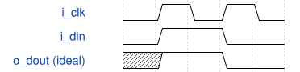

# tiny 模块规范

> RTL: `tiny.v`

## 1. 模块目的

用于真实标准单元解析和引脚路径核对的无反馈小电路

## 2. 参数

| 参数 | 默认值 | 说明 |
| --- | --- | --- |
| — | — | 本模块没有可配置参数。 |

## 3. 时钟与复位

- 时钟：`{"name": "i_clk", "active_level": "high", "waveform_ns": [5, 10], "period_ns": 10}`
- 复位：`{"present": false, "initial_state": "unknown"}`

## 4. 接口信号规范

| 信号 | 方向 | 位宽 | 时钟域 | 语义角色 | 描述 |
| --- | --- | --- | --- | --- | --- |
| `i_clk` | input | 1 | 未声明 | clock | 高电平透明使能，低电平保持 |
| `i_din` | input | 1 | 未声明 | data | 首级数据输入 |
| `o_dout` | output | 1 | 未声明 | data | 经三级锁存器和组合门的数据输出 |

## 5. 周期行为与延迟

- 三个 dlxtp_1 使用同一高电平使能；高电平时经真实单元传播，低电平时保持。
- L1/Q 分叉为三个 BUF 的长支路和一个 BUF 的短支路，两支路接 AND2，再进入 L2。
- 本电路不保证固定三周期延迟；同相 latch 在一个透明窗口中可能穿透多级。

## 6. WaveDrom 时序图

### 同相 latch 的理想透明与保持

示意图不代表仿真结果；忽略实际单元延迟，初始化后高电平透明、低电平保持。

- WaveJSON：[tiny_transparent-hold.json5](waveforms/tiny_transparent-hold.json5)

## 7. 边界、反压与错误

- 无复位时仿真初值为 X；须先在高电平窗口施加已知输入。
- 同相 latch 可能穿透或发生 hold 违例。
- 长短分支的逻辑功能相同；该结构用于真实时序弧和重汇合路径核对。

## 8. CDC 与综合约束

- 使用完整 SKY130 HD tt_025C_1v80 Liberty；当前目录中的 JSON 碎片不足以链接全部单元。
- 保持 L1/L2/L3、七个 BUF 和一个 AND2 的实例拓扑。
- 不在 Verilog 中写 # 延迟；物理延迟由 Liberty 和实际 slew/load 决定。
- 首版理想时钟、无互连 RC；必须单独检查 setup/hold，不能把功能正确等同于时序通过。

## 9. 验证与验收

- 确认恰有 3 个 dlxtp_1、7 个 buf_1 和 1 个 and2_1。
- 确认 L1/Q 到 L2/D 的长短路径经过不同实例。
- 以布尔抽象确认透明时输出随输入，关闭时保存状态；此检查不包含单元传播延迟。
- 使用 Yosys hierarchy/check 和 OpenSTA link_design/report_checks 进行后续实际验证。

## 10. 可追溯性

- 规格模块：`tiny`
- RTL 路径：`tiny.v`
- 交付要求：本文档、WaveJSON 和 SVG 必须与同一版本规格一同发布。
